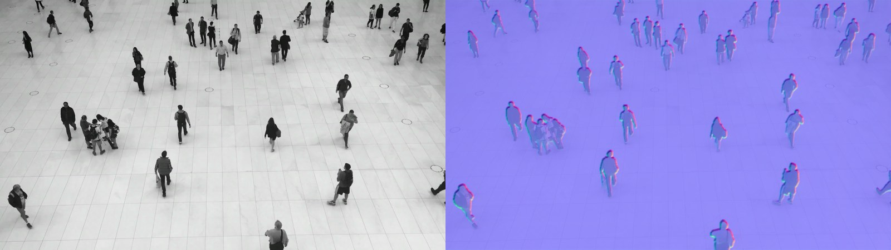
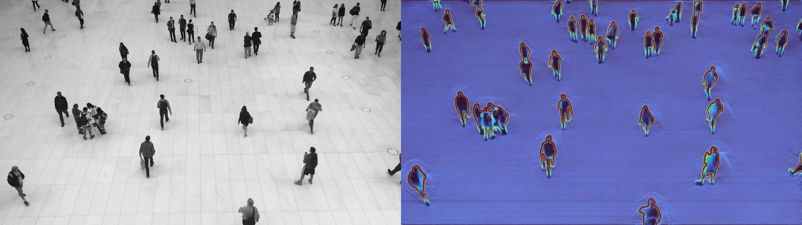

# Depth and Map Annotators

`sv.DepthAnnotator` colours depth and disparity maps. `sv.NormalMapAnnotator` and `sv.GradientMapAnnotator` colour normal and gradient maps over an image.

=== "DepthAnnotator"

    ```python
    import supervision as sv

    image = ...
    depth_map = sv.DepthMap(...)

    depth_annotator = sv.DepthAnnotator(opacity=0.65)
    annotated_image = depth_annotator.annotate(
        scene=image.copy(),
        depth_map=depth_map,
    )
    ```

    <div class="result" markdown>

    { align=center width="800" }

    OpenCV SGBM disparity over the frame (left) and the ground truth (right). Spring dataset by Mehl et al. ([doi:10.18419/darus-3376](https://doi.org/10.18419/darus-3376)) and Spring open movie by Blender Foundation, [CC BY 4.0](https://creativecommons.org/licenses/by/4.0/); downscaled.

    </div>

=== "NormalMapAnnotator"

    ```python
    import supervision as sv

    image = ...
    normal_map = ...  # float array shaped (H, W, 3): x, y, z normal components

    normal_map_annotator = sv.NormalMapAnnotator(opacity=0.8)
    annotated_image = normal_map_annotator.annotate(
        scene=image.copy(),
        normal_map=normal_map,
    )
    ```

    <div class="result" markdown>

    { align=center width="800" }

    Image (left) and an illustrative normal map derived from image-space gradients of a Depth Anything V2 relative inverse-depth map (right). Small gradients appear mostly violet, while depth edges shift towards red, green and cyan. These colours visualize a synthetic height field, not calibrated 3D surface orientations.

    </div>

=== "GradientMapAnnotator"

    ```python
    import supervision as sv

    image = ...
    gradient_map = ...  # float array shaped (H, W) or (H, W, 2)

    gradient_map_annotator = sv.GradientMapAnnotator(opacity=0.8)
    annotated_image = gradient_map_annotator.annotate(
        scene=image.copy(),
        gradient_map=gradient_map,
    )
    ```

    <div class="result" markdown>

    { align=center width="800" }

    Image (left) and the magnitude of a Depth Anything V2 depth map's x and y derivatives (right). Depth edges glow along the outline of each person.

    </div>

<div class="md-typeset">
    <h2><a href="#supervision.depth.annotators.DepthAnnotator">DepthAnnotator</a></h2>
</div>

:::supervision.depth.annotators.DepthAnnotator

<div class="md-typeset">
    <h2><a href="#supervision.depth.annotators.DepthClipRange">DepthClipRange</a></h2>
</div>

:::supervision.depth.annotators.DepthClipRange

<div class="md-typeset">
    <h2><a href="#supervision.depth.annotators.NormalMapAnnotator">NormalMapAnnotator</a></h2>
</div>

:::supervision.depth.annotators.NormalMapAnnotator

<div class="md-typeset">
    <h2><a href="#supervision.depth.annotators.GradientMapAnnotator">GradientMapAnnotator</a></h2>
</div>

:::supervision.depth.annotators.GradientMapAnnotator

<div class="md-typeset">
    <h2><a href="#supervision.depth.colormaps.DepthColormap">DepthColormap</a></h2>
</div>

:::supervision.depth.colormaps.DepthColormap

<div class="md-typeset">
    <h2><a href="#supervision.depth.core.DepthScale">DepthScale</a></h2>
</div>

:::supervision.depth.core.DepthScale
