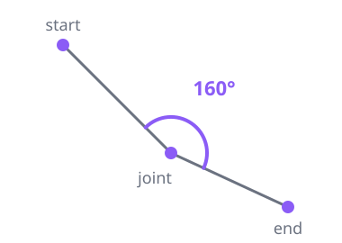

# Joint Angles

A joint angle is measured at the `joint` point, between the rays that run to the `start` and `end` points.

{ align=center width="380" }

  <h2><a href="#supervision.key_points.angles.JointAngle">JointAngle</a></h2>

:::supervision.key_points.angles.JointAngle

  <h2><a href="#supervision.key_points.angles.joint_angles">joint_angles</a></h2>

:::supervision.key_points.angles.joint_angles
